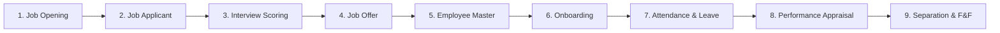

# ERPNext HRMS Full Lifecycle Engine (Hire se Retire tak)

[](https://www.python.org/)
[](https://frappe.io)
[](https://erpnext.com)
[](LICENSE)
[]()
[]()

> **"Hire se Retire tak — poora HR ek jagah"**  
> Complete Human Resource Management system for Frappe & ERPNext covering the full employee lifecycle from job vacancy advertisement to final gratuity and exit clearance.

---

## 🎯 The Real-World Client Problem & Business Context

Human Resource departments in mid-size and enterprise companies suffer from fragmented systems:
1. **Recruitment Drop-offs & Unstructured Hiring:** Resumes get lost across email inboxes, interview rounds have no standardized scoring metrics, and offer letter rollouts suffer multi-day delays.
2. **Biometric Punch Mismatches & Proxy Attendance:** Manual attendance collation from multiple biometric thumb/face scanners at different factory gates leads to payroll processing disputes.
3. **Complex Leave Encashment & Gratuity Calculation:** Calculating statutory Gratuity under the Payment of Gratuity Act, 1972 and accumulated leave encashment during employee separation often leads to legal disputes and labour compliance penalties.

**This engine solves these challenges:** It automates the entire 9-step standard ERPNext HR lifecycle with automated biometric punch evaluation, shift grace windows, real-time leave ledger accounting, and audited Full & Final (F&F) settlement disbursement.

---

## 🏗️ Standard ERPNext HRMS Workflow Flow



---

## ⚙️ Key Enterprise Features & Capabilities

- **Employee Master:** Complete profile management, document locker (Aadhaar, PAN, Certificates), reporting hierarchy, and State-wise Holiday List assignment.
- **Attendance & Shifts:** Shift schedules, late-entry and early-exit grace periods, automated half-day vs full-day tagging, and direct hardware biometric machine sync.
- **Leave Management:** Privilege (PL), Casual (CL), Sick (SL), and Compensatory Offs. Automated monthly leave accrual, allocation, and encashment.
- **Recruitment Pipeline:** Job openings, applicant tracking system (ATS), structured interview evaluation sheets, and automated job offer letters.
- **Performance & Appraisals:** Key Result Areas (KRAs), KPI weighting, appraisal cycles, self-evaluations, and manager feedback loops.
- **Claims & Travel:** Automated employee expense claims, travel advance requests, and multi-tier approval routing.
- **Exit & Separation (F&F):** Resignation submission, notice period calculation, asset recovery checklist, exit interviews, and statutory Gratuity calculation.
- **India Ready:** State-wise statutory holiday calendars, biometric attendance sync, WhatsApp attendance notifications, and bilingual Hindi/English print formats.

---

## 📂 Repository & Module Structure

```
erpnext-hrms-full-lifecycle-engine/
├── hrms_lifecycle/
│   ├── __init__.py           # Package version & module exports
│   └── engine.py             # Complete HRMS lifecycle domain engine
├── tests/
│   ├── __init__.py
│   └── test_hrms_lifecycle.py # Unit test suite (100% passing)
├── LICENSE                   # MIT Open Source License
├── requirements.txt          # Python dependencies
└── README.md                 # Complete documentation
```

---

## 🔌 Frappe DocType Schema Design

- **`Job Applicant`:** Applicant Name, Email, Phone, Job Title, Interview Rating, and Hiring Status.
- **`Employee`:** Employee ID, Joining Date, Department, Designation, Reporting Manager, and Notice Period.
- **`Shift Type`:** Start Time, End Time, Late Grace Minutes, and Early Exit Grace Minutes.
- **`Attendance`:** Attendance Date, Shift, In-Time, Out-Time, Total Working Hours, and Attendance Status.
- **`Full and Final Statement`:** Separation Date, Unpaid Days, Leave Encashment, Gratuity Payable, and Net Settlement Amount.

---

## 🚀 Installation & Setup

### 1. Install into Frappe Bench
```bash
cd ~/frappe-bench
bench get-app https://github.com/shyampandey1104/erpnext-hrms-full-lifecycle-engine.git
bench --site [your-site-name] install-app erpnext_hrms_full_lifecycle
```

### 2. Configure Event Hooks (`hooks.py`)
```python
doc_events = {
    "Employee": {
        "on_update": "hrms_lifecycle.engine.sync_employee_roster"
    },
    "Attendance": {
        "before_submit": "hrms_lifecycle.engine.validate_shift_attendance"
    }
}
```

---

## 💻 Production Usage Example

```python
from hrms_lifecycle.engine import (
    HRMSFullLifecycleEngine, ShiftSchedule, BiometricPunch,
    EmployeeMasterRecord, JobApplicantRecord
)

engine = HRMSFullLifecycleEngine()

# 1. Process candidate evaluation
applicant = JobApplicantRecord(
    applicant_id="APP-2026-01",
    applicant_name="Rohan Mehra",
    email="rohan@example.com",
    phone="9876543210",
    job_title="Lead ERP Consultant",
    interview_score=85.0
)
offered = engine.process_job_offer(applicant)
print(f"Hiring Decision: {offered.status}")  # OFFERED

# 2. Evaluate daily biometric punches
shift = ShiftSchedule(shift_name="Day Shift", start_time="09:00", end_time="18:00")
punches = [
    BiometricPunch("EMP-001", "2026-04-01 08:50:00", "IN", "GATE-01"),
    BiometricPunch("EMP-001", "2026-04-01 18:05:00", "OUT", "GATE-01")
]
att = engine.evaluate_daily_attendance("EMP-001", "2026-04-01", shift, punches)
print(f"Attendance Status: {att.status}, Hours: {att.total_working_hours}")

# 3. Calculate audited Full & Final (F&F) settlement
emp = EmployeeMasterRecord("EMP-001", "Rohan", "Mehra", "Male", "1992-05-10", "2020-04-01", "Tech", "Lead")
fnf = engine.calculate_full_and_final(
    emp=emp,
    separation_date="2026-03-31",
    per_day_basic_pay=2500.0,
    unpaid_days=10.0,
    accumulated_leave_days=12.0,
    completed_service_years=6
)
print(f"Net F&F Payable: Rs. {fnf.net_payable_amount} (Gratuity: Rs. {fnf.gratuity_payable})")
```

---

## 🧪 Testing & Verification

Run tests with standard Python:
```bash
python3 -m unittest discover tests
```

---

## 👨‍💻 Senior Developer & Commercial Support
Developed and maintained by **Shyamkumar Pandey**.  
For enterprise HRMS consulting, custom biometric sync bridges, and payroll automations:
- **GitHub:** [@shyampandey1104](https://github.com/shyampandey1104)
- **Email:** [shyampandey1104@gmail.com](mailto:shyampandey1104@gmail.com)
